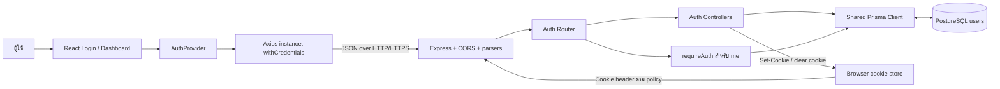
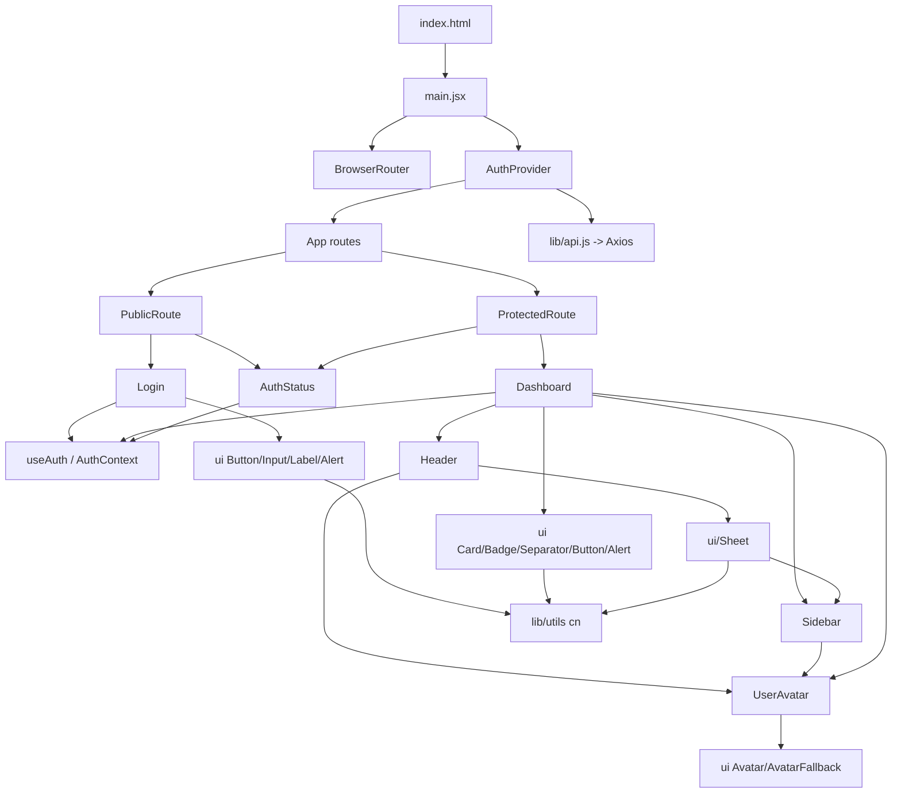
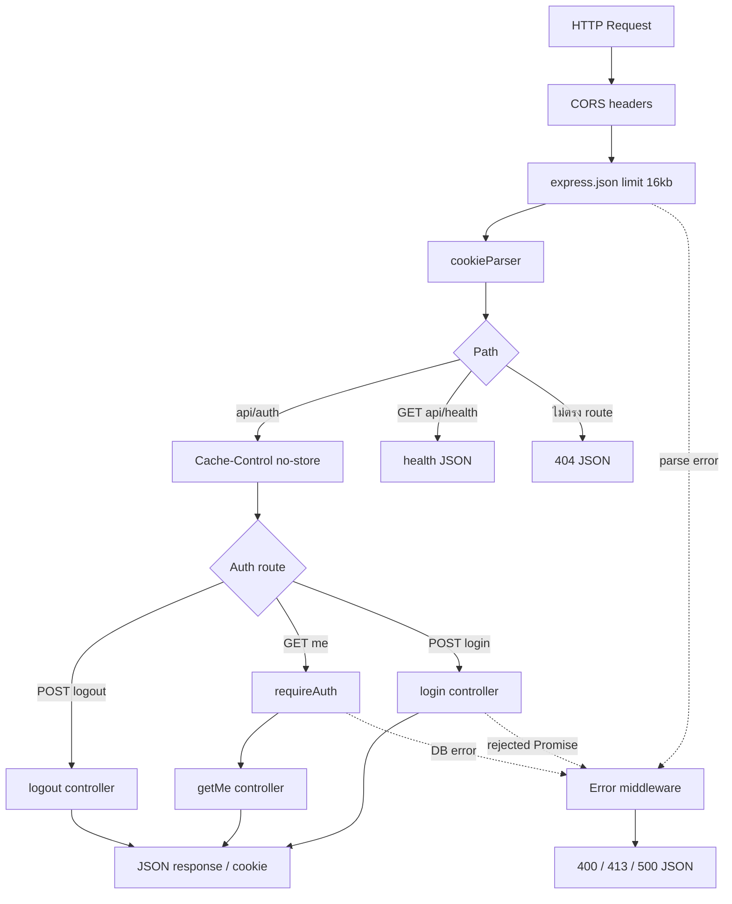

# Full System Code Audit & Code Walkthrough — Login Dashboard V1

วันที่ตรวจ: 17 พฤศจิกายน 2026 · ภาษา: JavaScript/JSX แบบ ES Modules · โหมด: อ่านโค้ดและสร้างรายงานนี้เท่านั้น

> **ขอบเขตความเชื่อมั่น:** อ่าน source/config/tests/scripts ที่มีอยู่จริงใน checkout ปัจจุบัน ไม่รัน application, HTTP requests, build, lint, tests, npm audit, Prisma CLI หรือ SQL ในรอบนี้ ไม่แก้ source/config/.env/Database และไม่ติดตั้ง package ผล PASS ในรายงานหมายถึงตรวจหลักฐานจาก source ได้ ไม่ใช่ยืนยัน runtime โดยการรันใหม่ ผลทดสอบเก่าถูกแยกไว้ชัดเจน ไม่แสดงข้อมูลลับหรือค่าการเชื่อมต่อฐานข้อมูล

## Findings ที่ควรอ่านก่อน

| ID | ประเภท | Severity | สิ่งที่พบและหลักฐาน | ข้อเสนอสำหรับพิจารณา ไม่ได้ลงมือแก้ |
| --- | --- | --- | --- | --- |
| F01 | ISSUE ด้านความปลอดภัยในการรัน tests | High | `backend/package.json:7` รันทุก test; `backend/test/auth.integration.test.js:24` insert และ `:175` delete fixtures ผ่าน Prisma ที่ใช้ connection จาก environment (`backend/src/lib/prisma.js:1`) ไม่มี guard ยืนยันว่าเป็น test DB | แยก connection สำหรับ test และ fail ก่อน write เมื่อไม่ใช่ DB ทดสอบ อย่ารัน Backend full suite กับข้อมูลที่ต้องรักษา |
| F02 | WARNING ก่อนเปิด public | High | Login ไม่มี server-side rate limiter/attempt counter ระหว่าง `backend/src/server.js:11` → `backend/src/routes/auth.routes.js:6` → `backend/src/controllers/auth.controller.js:19` | เพิ่ม throttling ที่ login โดยคำนึงทั้ง IP/account และพฤติกรรมผู้ใช้จริง ปุ่ม disabled ฝั่ง React ป้องกันได้เฉพาะการกดซ้ำใน UI |
| F03 | WARNING dependency advisory | High ตาม advisory; ผลต่อ app ยังไม่ยืนยัน | Lockfile มี `deepmerge-ts@7.1.5` (`backend/package-lock.json:388`) และ `effect@3.18.4` (`:465`) ผ่าน Prisma config ซึ่งอยู่ใน affected ranges ของ advisories ที่ตรวจจากแหล่งเผยแพร่ | ประเมิน update ที่เข้ากันได้และทดสอบแยก ไม่สรุปว่า auth API ถูก exploit ได้จากการมี package อย่างเดียว ดู Part 7 |
| F04 | WARNING ก่อน production | Medium | Cookie-based auth มี SameSite แต่ไม่มี Origin/CSRF validation ใน route chain (`backend/src/server.js:11`, `backend/src/routes/auth.routes.js:6`, `backend/src/controllers/auth.controller.js:35`) | ประเมิน CSRF defense ให้ตรง origins/sites จริง โดยเฉพาะ endpoint เปลี่ยนสถานะ เช่น logout; CORS ไม่ใช่ตัวแทน CSRF protection |
| F05 | WARNING ด้าน timing | Medium | `backend/src/controllers/auth.controller.js:19` short-circuit เมื่อไม่มี user/inactive จึงไม่ทำ bcrypt แต่ password ผิดของ active user ต้อง compare | ข้อความกลางทำได้ดีแล้ว; พิจารณา dummy bcrypt comparison สำหรับ failure paths พร้อม rate limiting ความต่างเวลาใน network ยังไม่ได้วัด |
| F06 | NOT VERIFIED | Medium | Source เปรียบเทียบกับ `password_hash` แต่ไม่สร้าง/ตรวจ cost ของ hash ของบัญชีจริง (`backend/src/controllers/auth.controller.js:19`); hash cost 12 พบใน test เท่านั้น (`backend/test/auth.integration.test.js:22`) | ยืนยันขั้นตอนสร้าง hash ของบัญชี DBeaver โดยไม่เปิดเผย hash/password; ยังสรุปไม่ได้ว่า hash จริงเป็น bcrypt cost 12 |
| F07 | WARNING deployment | Medium | `secure` ขึ้นกับ `NODE_ENV === 'production'` (`backend/src/config.js:18`), secret ตรวจเพียงความยาว (`:4`) และ frontend มี local API fallback (`frontend/src/lib/api.js:4`) | ตรวจ HTTPS, production env, origin/API URL และ secret entropy ก่อน deploy เงื่อนไขใน code ไม่ยืนยัน deployment จริง |
| F08 | ISSUE ใน test runner/reporting | Low | ถ้า fetch/locator/launch throw ก่อน `record()` ถูกเรียก `frontend/scripts/e2e-local.mjs:130` จะแจ้ง generic stop และ save รายการก่อนหน้า แต่ไม่เพิ่ม failing step; `ui-smoke.mjs:77` ตั้ง exit code โดยไม่เก็บรายละเอียด exception | บันทึกชื่อ phase ที่กำลังทำและสถานะ FAIL/NOT VERIFIED แบบไม่เก็บ secrets เพื่อไม่ให้ JSON มีแต่ PASS ทั้งที่ process ล้มเหลว |
| F09 | WARNING UX ขณะ session หมดอายุ | Low | State ถูก recheck ตอน mount/focus/manual เท่านั้น (`frontend/src/context/AuthContext.jsx:59`, `:64`, `frontend/src/pages/Dashboard.jsx:70`) | ป้าย Signed in เป็นสถานะที่ตรวจครั้งล่าสุด ถ้าเปิด tab ค้างโดยไม่มี event อาจแสดงข้อมูลเก่าหลัง token หมดอายุ Backend ยังตรวจ expiry จริง ไม่ใช่ auth bypass |
| F10 | ข้อเสนอ Code Quality | Low | JSX บางบรรทัดรวม markup/handlers ยาวมาก เช่น `frontend/src/pages/Login.jsx:77`, `frontend/src/pages/Dashboard.jsx:54`; CardHeader มี utility อ้าง slot เก่าที่ไม่มี component แล้ว (`frontend/src/components/ui/card.jsx:26`) | ค่อยแยกบรรทัดให้อ่านง่าย/ตัด utility ที่ยืนยันว่าไม่ใช้ ไม่ต้องเปลี่ยนสถาปัตยกรรม |

ไม่พบหลักฐานจาก source ว่ามีเส้นทาง public ที่ส่ง password hash/JWT ใน JSON หรือ `/me` ที่ข้ามการ verify token แต่ยังไม่รับรองความปลอดภัยทุกกรณีหรือความสำเร็จของบัญชีจริงจากการอ่านโค้ดอย่างเดียว

---

## Part 1 — Project Overview

### 1.1 Directory tree ที่พบจริง

ไม่แสดง node_modules, dist, .git หรือ generated/build outputs ภายใน รายงานนี้เป็นไฟล์เดียวที่เพิ่ม

```text
Login/
├── .vscode/settings.json
├── CLEANUP_REPORT.md
├── CODE_AUDIT_AND_WALKTHROUGH.md
├── backend/
│   ├── .env
│   ├── .env.example
│   ├── .gitignore
│   ├── package.json
│   ├── package-lock.json
│   ├── prisma.config.ts
│   ├── prisma/schema.prisma
│   ├── README.md
│   ├── src/
│   │   ├── server.js
│   │   ├── config.js
│   │   ├── routes/auth.routes.js
│   │   ├── controllers/auth.controller.js
│   │   ├── middleware/auth.middleware.js
│   │   └── lib/prisma.js
│   └── test/
│       ├── auth.integration.test.js
│       └── server.integration.test.js
└── frontend/
    ├── .env.example
    ├── .gitignore
    ├── package.json
    ├── package-lock.json
    ├── index.html
    ├── components.json
    ├── jsconfig.json
    ├── vite.config.js
    ├── vitest.config.js
    ├── eslint.config.js
    ├── README.md
    ├── TEST_REPORT.md
    ├── public/favicon.svg
    ├── scripts/
    │   ├── e2e-local.mjs
    │   └── ui-smoke.mjs
    └── src/
        ├── main.jsx
        ├── App.jsx
        ├── index.css
        ├── pages/Login.jsx, Dashboard.jsx
        ├── context/AuthContext.jsx, auth-context.js, useAuth.js
        ├── lib/api.js, utils.js
        ├── components/
        │   ├── AuthStatus.jsx, Brand.jsx, UserAvatar.jsx
        │   ├── ProtectedRoute.jsx, PublicRoute.jsx
        │   ├── layout/Header.jsx, Sidebar.jsx
        │   └── ui/alert.jsx, avatar.jsx, badge.jsx, button.jsx,
        │          card.jsx, input.jsx, label.jsx, separator.jsx, sheet.jsx
        └── test/auth.test.jsx, setup.js
```

ใน checkout นี้ไม่พบ seed script, Registration API, Refresh Token API หรือ migration files ไม่มี frontend `.env`; frontend จึงใช้ค่า fallback ถ้าไม่มี environment ที่ถูก inject จากภายนอก (`frontend/src/lib/api.js:4`) ส่วน connection ของ DB มีชื่อ variable ใน backend `.env` แต่ไม่ได้เชื่อมต่อ DB เพื่อยืนยันสภาพจริง

### 1.2 Entry points และ scripts

- Browser อ่าน `frontend/index.html:12` เพื่อหา `<div id="root">` และ `:13` โหลด `src/main.jsx` จากนั้น React เรียก `App` ผ่าน Router/Provider (`frontend/src/main.jsx:8`)
- Backend `npm start`/`npm run dev` ชี้ `src/server.js` (`backend/package.json:8`) โค้ดแยก export app ออกจากการ listen จึง import เข้า tests ได้โดยไม่เปิด server อัตโนมัติ (`backend/src/server.js:37`)
- Frontend `dev`, `build`, `preview` ใช้ Vite; `lint` ใช้ ESLint; `test`/`test:watch` ใช้ Vitest; `test:ui`/`test:e2e` เรียก scripts ที่มีผลข้างเคียงจริง (`frontend/package.json:6`)
- Backend `test` ใช้ Node test runner, `prisma:generate` สร้าง client files, `prisma:validate` ตรวจ schema (`backend/package.json:6`) ไม่ได้รันใน audit นี้

### 1.3 Technologies ที่ใช้จริง

เวอร์ชันต่อไปนี้อ่านจาก package-lock ไม่ใช่การเดาจาก range ใน package.json:

| ระบบ | Packages และ locked versions | ใช้ทำอะไร |
| --- | --- | --- |
| Backend runtime | Express 5.3.0, cors 2.8.6, cookie-parser 1.4.7, dotenv 18.0.10 | HTTP routing/middleware, browser origin headers, cookie parsing, environment loading |
| Backend auth/DB | bcryptjs 3.0.3, jsonwebtoken 9.0.3, @prisma/client 6.19.2 | เปรียบเทียบ hash, sign/verify JWT, อ่าน PostgreSQL |
| Backend CLI | prisma 6.19.2 | ตรวจ schema/generate client; ตรงกับ Client version |
| Frontend runtime | React/React DOM 19.3.1, react-router 7.18.5, axios 1.21.1 | component/state/render, client routing, HTTP client |
| UI runtime | lucide-react 1.74.0, radix-ui 1.8.1, class-variance-authority 0.7.1, clsx 2.1.1, tailwind-merge 3.7.0 | icons, accessible primitives, variants, class merging |
| Frontend styling/build | Vite 8.3.8, @vitejs/plugin-react 6.3.0, Tailwind/@tailwindcss/vite 4.3.5, tw-animate-css 1.4.0 | transform JSX, dev/build, utilities/theme/Sheet transitions |
| Frontend tests | Vitest 5.1.0, jsdom 29.1.1, Testing Library React 16.3.3/user-event 14.6.1/jest-dom 7.0.1, axios-mock-adapter 2.1.0, playwright-core 1.65.1 | DOM assertions, mock API, browser automation |
| Frontend tooling | ESLint 10.15.0, @eslint/js 10.0.1, hooks plugin 7.1.1, refresh plugin 0.5.8, globals 17.14.0, @types/react 19.3.0/@types/react-dom 19.3.0 | lint rules, JSX editor/types tooling |

shadcn/ui ในระบบนี้คือ source ของ primitives ที่อยู่ใน `components/ui` ไม่ได้ import runtime package ชื่อ shadcn ใช้ `tsx: false` ตาม `frontend/components.json:5` โค้ด application เป็น JS/JSX; `prisma.config.ts` เป็น configuration ของ Prisma CLI ที่มีอยู่จริง ไม่ใช่ application runtime TypeScript

### 1.4 Environment และข้อมูลที่ไม่เปิดเผย

อ่านเฉพาะชื่อและสถานะ: Backend มี `DATABASE_URL`, `PORT`, `JWT_SECRET`, `FRONTEND_URL`, `NODE_ENV` ตั้งค่าอยู่ และ `SEED_ADMIN_PASSWORD` ว่าง ตัวหลังไม่มี consumer ใน runtime ปัจจุบัน ไม่แก้หรือลบค่าใด `.env.example` เป็น template ไม่ใช่ตัวที่ runtime โหลดแทน `.env`

- dotenv ถูก import ใน `backend/src/config.js:1` และ `backend/src/lib/prisma.js:1` เพื่อให้ process เห็น environment ก่อนตรวจ config/สร้าง client
- ค่าที่กำหนดใน process environment อาจต่างจาก `.env`; การเห็นไฟล์ set ไม่ยืนยันค่าที่ process server ใช้อยู่จริง
- `VITE_API_BASE_URL` ใช้ฝั่ง browser เป็น public config (`frontend/src/lib/api.js:4`) ไม่ควรเก็บ secrets ด้วย prefix นี้
- Backend `.gitignore:3` และ Frontend `.gitignore:27` ignore env; ไม่ยืนยันว่ามี secret เคยอยู่ใน Git history หรือไม่ เพราะ checkout นี้ไม่มี Git repository
- ไม่พบ connection values/hashes/tokens ในรายงานนี้; ไม่ตรวจจริงว่าบัญชี DB มีสิทธิ์น้อยที่สุดหรือ TLS/backup ถูกตั้งอย่างไร

---

## Part 2 — System Architecture

### 2.1 หน้าที่ของแต่ละชั้น

Frontend ดูแลฟอร์ม, UI state, navigation และแสดง public user Backend ตรวจ credentials และ token ทุกครั้งที่อ่าน `/me` Prisma แปลงคำสั่งจาก JS ไปยัง PostgreSQL Browser จัดเก็บ/แนบ cookie ให้เอง React ไม่ต้องอ่าน JWT



### 2.2 Frontend dependency diagram



ใช้ Provider เป็นแหล่ง auth state เดียว Header/Sidebar อ่านผ่าน hook; ไม่ได้สร้าง user state แยกกันทุกหน้า ข้อมูลเดียวกันจึงเปลี่ยนพร้อมกันเมื่อ login/logout (`frontend/src/context/AuthContext.jsx:101`)

### 2.3 Backend request pipeline



ลำดับ middleware สำคัญ: ถ้าย้าย cookieParser หลัง auth routes `req.cookies` จะยังไม่พร้อม; ถ้าไม่ parse JSON controller จะไม่มี body object ที่คาดหวัง; ถ้าย้าย 404 ก่อน routes เส้นทางจริงอาจไม่ได้รับงาน (`backend/src/server.js:11` ถึง `:35`)

---

## Part 3 — Backend File-by-File Walkthrough

### 3.1 `backend/src/server.js`

**หน้าที่:** ประกอบ HTTP application, middleware, endpoint, error boundary และ lifecycle **Imports:** Express/CORS/cookie-parser, `pathToFileURL` จาก Node, config, Prisma singleton และ router (`:1`) **Export:** named `app` (`:9`) ไม่มี default export

Top-level statements ไม่ได้อยู่ใน function แต่รันทันทีเมื่อ module ถูก import: สร้าง app, ปิด `x-powered-by`, ต่อ middleware และ route handlers ส่วน listen ทำเฉพาะเมื่อไฟล์เป็น entry point (`:37`) เงื่อนไขเปรียบเทียบ file URL ของ module กับ path ที่ Node กำลังเรียก ทำให้ tests import app แล้วค่อยเลือก port เองได้

| Function/callback | Input และผู้เรียก | การประมวลผล / output / errors |
| --- | --- | --- |
| Auth cache middleware `:14` | Express ส่ง `req,res,next` สำหรับ prefix `/api/auth` | เรียก `res.set` เพื่อห้าม cache แล้ว `next()` ส่งต่อ ไม่อ่าน credentials ไม่คืน JSON เอง |
| Health callback `:18` | Express เมื่อ GET `/api/health` | ส่ง 200 `{success:true,message:"Backend is running"}` ไม่ถาม DB ดังนั้น 200 ไม่ได้แปลว่า DB พร้อม |
| 404 callback `:21` | Express หลังไม่มี route ก่อนหน้าส่ง response | ส่ง 404 `{success:false,message:"Not found"}` ไม่มี async |
| Error callback `:25` | Express ส่ง `error,req,res,next` เมื่อ throw/reject/parser error | ถ้าส่ง headers แล้วใช้ `next(error)`; parse failed →400, body ใหญ่→413, อื่น→log ข้อความกลางแล้ว500 ไม่ส่ง stack/query ให้ client |
| Listen callback `:38` | Node HTTP server หลัง bind port สำเร็จ | log port จริงจาก `server.address()` จึงรองรับ PORT 0 สำหรับ test คืน undefined |
| Server error callback `:41` | server event `error` | async รอ Prisma disconnect แล้วตั้ง exitCode 1 ไม่ได้ retry/start port ใหม่ |
| Signal callback `:47` | process.once สำหรับ SIGINT หรือ SIGTERM | สั่ง `server.close()` หยุดรับ connection ใหม่แล้วรอ callback ไม่ส่ง HTTP response |
| Close callback `:48` | Node หลังปิด HTTP server | async รอ `$disconnect()` แล้วตั้ง exitCode 0 ไม่มี timeout/forced shutdown fallback |

`error,req,res,next` ต้องมีสี่ parameters เพื่อให้ Express ระบุว่าเป็น error middleware แม้ `req` ไม่ถูกอ่าน เป็น parameter ตาม contract ไม่ควรลบทิ้งเพียงเพราะดู unused

Express ที่ lock เป็นเวอร์ชัน 5 จึงส่ง rejected Promises จาก async controller/middleware ไป error handler ได้ ไม่ต้องใส่ try/catch ซ้ำทุก query อ้างอิง [Express 5 error handling](https://expressjs.com/en/5x/guide/error-handling/) ส่วน callback ของ Node events อยู่นอก Express pipeline จึงไม่ได้ใช้ error handler นี้

**ถ้าลบไฟล์:** HTTP server/API ทั้งหมดไม่มี entry point และ tests ที่ import app พัง

### 3.2 `backend/src/config.js`

**Imports:** side-effect `dotenv/config` **Exports:** `config`, `cookieOptions`, `tokenLifetimeMs`, `publicUserSelect` ไม่มี declared function

- `:3` require ชื่อ `DATABASE_URL`; `:4` ตรวจ secret อย่างน้อย 32 UTF-8 bytes และ throw ก่อน server listen เมื่อไม่ครบ ไม่ยืนยันความสุ่ม/ความแข็งแรงของ secret
- `config.port` `:8` แปลง string เป็น number; ค่า fallback 4000, ตรวจ integer 0–65535 ที่ `:12` จงใจอนุญาต 0 ให้ระบบเลือก port
- `config.frontendUrl` `:9` คือ origin สำหรับ CORS ไม่ใช่ DB URL; ไม่มี URL format validation
- `config.jwtSecret` `:10` ใช้ sign/verify ต้องเป็นค่าเดียวกัน ไม่ export ไป frontend
- `cookieOptions` `:16` ใช้ร่วมกันตอน set และ clear; HttpOnly true, Secure เฉพาะ production, SameSite lax, path root
- `tokenLifetimeMs` `:22` เท่ากับ 3,600,000 ms ใช้ maxAge; JWT อายุใน controller กำหนดอีกจุดเป็น `"1h"` สอดคล้องกันตอนนี้ แต่ถ้าปรับในอนาคตควรเปลี่ยนพร้อมกัน
- `publicUserSelect` `:23` เลือกเพียง id/username/email/role เป็น whitelist กัน field ลับหลุด

**ถ้าลบไฟล์:** controller/middleware/server import ไม่ได้ ไม่มี cookie/JWT/config ที่ใช้ร่วมกัน

### 3.3 `backend/src/lib/prisma.js`

**Imports:** dotenv และ `PrismaClient` จาก `@prisma/client`; **Export:** named `prisma` ที่ `:5` เป็น instance เดียวต่อ module/process ไม่มี wrapper function

ES module caching ทำให้ imports หลายที่ใช้ออบเจ็กต์เดียวกันใน process เดียว ไม่ได้สร้าง client ต่อ request ถ้ามีหลาย Node processes แต่ละ process ยังมี instance ของตัวเอง การสร้าง object ไม่ใช่หลักฐานว่า query DB สำเร็จ; การอ่านจริงเกิดเมื่อ `findUnique()` เป็นต้นทำงาน ใช้ generator/client เวอร์ชันเดียวกันตาม lockfiles

**ถ้าลบไฟล์:** login, requireAuth และ server shutdown import ล้มเหลว

### 3.4 `backend/src/routes/auth.routes.js`

**Imports:** `Router`, named controller functions, `requireAuth`; **Export:** default router (`:9`)

ไฟล์นี้ไม่ประกาศ business function แต่ register callbacks: `router.post('/login', login)` (`:6`), `router.get('/me', requireAuth, getMe)` (`:7`), `router.post('/logout', logout)` (`:8`) prefix `/api/auth` มาจาก server ไม่ต้องเขียนซ้ำในแต่ละ route `requireAuth` ใช้เฉพาะ me; logout จึงทำได้แม้ token ไม่มี/หมดอายุ

**ถ้าลบไฟล์:** server register auth routes ไม่ได้ แม้ controller ยังอยู่

### 3.5 `backend/src/controllers/auth.controller.js`

**Imports:** bcryptjs, jsonwebtoken, shared Prisma และ config/selection/cookie settings **Exports:** named `login`, `getMe`, `logout` routes เป็นผู้เรียก ไม่มี service/repository layer เพิ่ม

#### `login(req,res)` — บรรทัด 6

เป็น async function จึงคืน Promise ที่ Express รอได้ `req` คือ request object; `res` คือ response object ไม่ใช่ข้อมูล user

1. `:7` destructure username/password จาก body หรือ object ว่าง ป้องกันไม่มี body แล้วอ่าน property ไม่ได้
2. `:9`–`:13` ตรวจ type string, ไม่ว่างหลัง trim, username ไม่เกิน 50 JS code units และ password ไม่เกิน 72 UTF-8 bytes ถ้าไม่ผ่าน return 400 หยุด function
3. `.trim()` ใช้ตรวจความว่างเท่านั้น ไม่เปลี่ยนค่าที่ส่งค้น DB หรือ compare; username ที่มีช่องว่างหัวท้ายจะถูก query ตามข้อความนั้น ไม่ใช่ auto-trim
4. `:15` await `prisma.users.findUnique({where:{username},select:...})` ได้ selected user object หรือ null; DB error เป็น rejected Promise
5. `:19` ใช้ logical OR แบบ short-circuit: ไม่พบ user หรือ inactive → ไม่เรียก bcrypt; user active → await compare password กับ stored hash สำเร็จเป็น boolean
6. ไม่ผ่านทุกกรณีส่งข้อความกลางเดียวกัน 401 (`:20`) ลดการเปิดเผยว่า username มีอยู่หรือไม่ แต่ work/time paths ต่างกันตาม F05
7. `:22` `jwt.sign` แบบ synchronous สร้าง token จาก empty custom payload พร้อม subject=user.id, expiresIn 1h, algorithm HS256 ไม่ได้ใส่ role/hash/password ลง token
8. `:25` `res.cookie` เพิ่ม Set-Cookie header พร้อม token; ยังไม่ใช่การเก็บ token ใน React
9. `:26` rename destructuring `username: name` เพื่อตั้งชื่อ local variable ไม่ได้แก้ property ใน DB
10. `:27`–`:30` ส่ง 200 JSON ที่มี public user เท่านั้น

success return เป็นค่าจาก `res.status(...).json(...)` ภายใน async Promise; ค่าที่ browser ได้จริงคือ HTTP status/headers/body ไม่ใช่ Express response object หาก query/compare/sign throw เส้นทาง global error handler ส่ง500 ไม่มี try/catch เฉพาะ controllerนี้ตาม Express5

**เหตุผลที่ต้องมี:** รวม credential verification/token issuance ให้ routes อ่านง่ายและไม่มี auth logic ซ้ำใน React

#### `getMe(req,res)` — บรรทัด 32

sync handler อ่าน `req.user` ที่ middleware ใส่ไว้ ไม่อ่าน `req.body` และไม่ query DB ซ้ำ ส่ง 200 `{success:true,user:req.user}` หากเรียกข้าม middleware จะไม่มี guarantee ว่า req.user มี แต่ route ปัจจุบันประกาศ middleware ก่อนเสมอ (`routes/auth.routes.js:7`)

#### `logout(req,res)` — บรรทัด 35

sync handler ไม่ใช้ข้อมูล req เรียก `res.clearCookie('auth_token', cookieOptions)` (`:36`) ให้ browser ล้าง cookie ด้วยชื่อ/path/options เดียวกับตอนตั้ง ส่ง200 successที่`:37` ไม่ลบ user ไม่เขียน DB ไม่ revoke token ที่คัดลอกออกไปแล้ว ไม่มี auth middlewareหน้าฟังก์ชันนี้จึง idempotent ต่อสถานะ cookie ของ client

**ถ้าลบไฟล์:** auth router import handlers ทั้งสามไม่ได้

### 3.6 `backend/src/middleware/auth.middleware.js`

**Imports:** jwt, prisma, config/public selection **Export:** `requireAuth`; helper `unauthorized` เป็น local

#### `unauthorized(res)` — บรรทัด 5

รับ response object จาก middleware ไม่รับ token return response401ข้อความ `Unauthorized` และ success false ใช้รวม failure pathsให้contractเดียวกัน ไม่ asyncและไม่ throw โดยตั้งใจ

#### `requireAuth(req,res,next)` — บรรทัด 6

1. อ่าน `req.cookies.auth_token` (`:7`) ซึ่ง cookie-parser เตรียมไว้ controllerไม่ต้อง parse string เอง
2. ไม่มี token หรือไม่ใช่ string → return unauthorized (`:8`)
3. `:10`–`:14` try jwt.verify โดยจำกัด allowed algorithms เป็น HS256 ค่า secretเดียวกับsign ถ้าsignature/format/expiryไม่ผ่าน catchและ401
4. `:15`–`:19` ตรวจ payload เป็น object, มี numeric exp, string sub และ sub รูปแบบ UUID ก่อนให้ Prisma ทำงาน regex นี้ตรวจรูปแบบ UUID แบบทั่วไป ไม่บังคับ UUID version
5. await findUnique ตาม id (`:20`) เลือก public fields กับ active flag; ไม่พบหรือปิดบัญชี →401
6. rest destructuring `const {is_active,...publicUser}=user` (`:25`) ตัด internal flagออกก่อนตั้ง `req.user` (`:26`)
7. `next()` (`:27`) ส่งงานไป getMe หากfailก่อนนี้จะไม่เรียกgetMe

`jwt.verify` ที่ไม่ได้ส่ง callback เป็น synchronous; `await` ใน functionนี้ใช้กับ DB เท่านั้น try/catchครอบเฉพาะ JWT จึงไม่เปลี่ยน DB outageเป็น401: DB errorsไปglobal500 ซึ่งแยก “tokenไม่ผ่าน” ออกจาก “บริการผิดพลาด” ได้ถูกต้อง

**ถ้าลบไฟล์:** auth router importไม่ได้ และไม่มีขั้นตอนป้องกัน me หากมีใครนำ middlewareออกโดยพลการ

### 3.7 `backend/prisma/schema.prisma` และ `backend/prisma.config.ts`

Schema ไม่มี JS functions ใช้ประกาศ generator/datasource/model รายละเอียด fieldsอยู่Part6 CLIconfig import `defineConfig,env` ที่`:5` export default configที่`:7` ชี้ schemaและmigrations path พร้อมengine classic และ connectionจากenv ไม่มี migrationsในdirectoryที่ตรวจ ไม่ได้หมายความว่า DBไม่มีประวัติการจัดการจากเครื่องมืออื่น

**ถ้าลบ schema:** Prisma generate/validateและการพัฒนา DBmodelต่อทำไม่ได้ตามconfig แม้clientที่เคยgenerateแล้วอาจยังทำงานชั่วคราว ไม่ควรตีความว่าruntimeต้องอ่านschemaทุกrequest **ถ้าลบ CLIconfig:** สูญเสียการตั้งschema/env/engineตามworkflowเดิม CLIอาจ fallbackได้บางกรณีแต่ไม่รับรองว่าเหมือนเดิม

### 3.8 Backend tests และเอกสาร

- `test/auth.integration.test.js:12` คือ suite callbackรับ `t`; อ่านsnapshotusers (`:13`), สร้างUUID/passwordชั่วคราว, bcrypt.hashด้วยcost12 (`:22`), insertสองfixtures (`:24`), เปิดappบนport0 (`:30`), ทดสอบHTTPและcurl cookie jar, ในfinallyปิดserver/lบเฉพาะIDsที่สร้าง/ตรวจsnapshot/disconnect (`:172`) การมีfinallyไม่ใช่rollbackทุกsideeffectและไม่ทดแทนtest DBแยก
- helpers `request(path,options={})` `:35` คืนfetchPromise, `login(body)` `:36` serialize JSONและเรียกrequest, `checkPublic(data)` `:40` assertpublicfieldsและไม่พบsecret/hash/passwordในJSONไม่ส่งresponseเอง; `run=promisify(execFile)` `:142` ทำให้awaitcurlได้; Promiseexecutor `:30` จัดresolve/rejectของserver; callback `:173` resolveเมื่อcloseสำเร็จ
- subtestsประกาศที่`:47,52,56,72,79,82,90,95,100,105,110,121,127,135,159,169` ตรวจhealth,DB/hashcost,login/cookie,credentials,inactive,validation,JSONsyntax/size,me,tokenstates,CORS,logoutjar/attributesและtemporaryendpoint ตามลำดับ ทุกcallbackเป็นasyncและรับไม่มีparameter; failureคือassertthrow/rejectให้Node runnerนับ ไม่ใช่applicationHTTP errorhandler
- curlช่วง`:135` ใช้ temporarydirectory และrequestfilemode0600 (`:147`) ไม่ใส่passwordในcommandargumentsโดยตรง cleanupdirectoryในfinally (`:157`) ไม่รันในauditนี้เพราะเขียนไฟล์/DB
- `test/server.integration.test.js:8` spawnserverใหม่ด้วยDBendpointที่ตั้งใจไม่พร้อม เพื่อเช็คhealth200/login500และshutdown มีPromiseexecutor`:20`,timeout`:21`,child error/exit callbacks`:22`/`:23`,stdout callback`:24` ที่extractportเท่านั้น `finally`ส่งSIGTERMและรอexit (`:37`) อีกtestcallback`:44` importcookieconfigในchildที่NODE_ENVproductionแล้วassertSecure/HttpOnly ไม่มีHTTPSbrowserจริง
- `backend/package.json`/lockfileเป็นdependency/scriptcontracts; `.env.example`เป็นรายการตัวแปรสำหรับเตรียมเครื่อง; `.gitignore`ช่วยกันไฟล์ลับและgeneratedoutputเข้าGit แต่ไม่อ่านแก้ประวัติGitให้
- `backend/README.md`คือคู่มือและผลทดสอบในอดีต ไม่ใช่โค้ดที่applicationเรียก; ลบแล้วruntimeไม่เสียแต่ความรู้ใช้งานหาย **ถ้าลบtests:** serverอาจยังรันได้ แต่สูญเสียregressioncoverage ไม่มีเหตุให้ลบเพราะชื่อมีคำว่าtest

## Part 4 — Frontend File-by-File Walkthrough

### 4.1 React concepts ที่ใช้ในโปรเจกต์นี้

- **Component:** function ที่ React เรียกเพื่อคืน JSX อธิบายหน้าตา UI ไม่ได้คืน HTTP response เช่น `Login()` (`frontend/src/pages/Login.jsx:11`)
- **Props:** arguments จาก parent เช่น Headerรับ `{onLogout}` (`frontend/src/components/layout/Header.jsx:10`) ส่วน `children` คือ JSX ที่วางไว้ระหว่างtagของcomponent
- **useState:** คืน `[ค่าปัจจุบัน, setter]`; setterแจ้งReactให้renderใหม่ ไม่ใช่การแก้ค่าตัวแปรเดิมทันทีในcallbackที่กำลังรัน (`frontend/src/pages/Login.jsx:14`)
- **useRef:** เก็บobjectเดิมข้ามrender ค่า `.current` เปลี่ยนโดยไม่สั่งrender เหมาะกับDOMreference, pendinglockและin-flightPromise (`frontend/src/pages/Login.jsx:20`, `frontend/src/context/AuthContext.jsx:21`)
- **useEffect:** ทำsideeffectหลังcommitของcomponentและcleanupเมื่อdependenciesเปลี่ยน/unmount ไม่ใช่โค้ดที่รันทุกบรรทัดระหว่างrender ตัวอย่างfocuslistener (`frontend/src/context/AuthContext.jsx:64`)
- **useCallback:** เก็บidentityของfunctionตามdependencies ไม่ได้เรียกfunctionให้เอง และไม่ได้ทำให้syncfunctionกลายเป็นasync (`frontend/src/context/AuthContext.jsx:25`)
- **useContext:** อ่านค่าจากProviderที่อยู่เหนือcomponentในReacttree (`frontend/src/context/useAuth.js:5`) ไม่ใช่การดึงJWTจากbrowser
- **Controlled input:** `value={username}` และ `onChange`ทำให้Reactstateเป็นแหล่งค่าของinput (`frontend/src/pages/Login.jsx:76`) ไม่จำเป็นต้องqueryDOMเพื่ออ่านcredentialsตอนsubmit
- **Event handler:** functionที่ส่งให้React/primitiveเรียกเมื่อเกิดevent เช่น `onSubmit={handleSubmit}` ไม่มีวงเล็บท้ายเพราะต้องส่งfunction ไม่ใช่เรียกทันที (`frontend/src/pages/Login.jsx:66`)

### 4.2 `frontend/index.html` และ `frontend/src/main.jsx`

HTMLกำหนดlanguage, viewport, metadata, favicon, rootและmodulescript (`frontend/index.html:2` ถึง `:13`) ไม่มีapplicationfunction ถ้าลบHTMLจะไม่มีdocumentสำหรับVite/browser; ถ้าrootหาย `createRoot`ไม่มีDOMปลายทาง faviconอยู่ `frontend/public/favicon.svg:1` เป็นassetจากHTML ไม่มีAPIหรือstate ถ้าลบiconจะหาย/404แต่authไม่หยุดทำงาน

`main.jsx` import React StrictMode, createRoot, BrowserRouter, named AuthProvider, default App และCSS ไม่มีexport/functionที่ประกาศเอง `createRoot(...).render(...)` (`:8`) เป็นbootstrapคำสั่งระดับmodule

ลำดับparentจริงคือ StrictMode → BrowserRouter → AuthProvider → App; Providerไม่ใช้routerhookแต่หน้าภายในใช้ จึงต้องมีRouterครอบก่อน StrictModeช่วยตรวจsideeffectsในdevelopment อาจทำeffectsetupซ้ำ จึงมีin-flightdeduplicationในProvider ไม่ควรตีความว่าproductionจะเรียกAPIซ้ำเสมอ

**ถ้าลบ main.jsx:** Reactไม่เริ่มrender **ถ้าลบ index.css import/file:** moduleโหลดไม่สำเร็จหรือUIสูญเสียstyles ทั้งCSScustomและTailwind

### 4.3 `frontend/src/App.jsx` — `App()` บรรทัด 10

**Imports:** Router APIs, Login/Dashboard, guardสองตัว, Brand/Button/icon **Export:** default App **Props/state/hooks/API:** ไม่มีstateหรือAPIของตัวเอง คืน `<Routes>`

- `/` → Navigate `/dashboard` แบบreplace (`:13`)
- `/login` อยู่ใต้PublicRoute (`:14`)
- `/dashboard` อยู่ใต้ProtectedRoute (`:15`)
- pathอื่น →404 UI และLinkกลับ `/` (`:16`)

`replace`แทนที่historyentryปัจจุบันแทนpush จึงลดการกดBackวนเข้าหน้าก่อนredirect Routerguardตัดสินตามcontextไม่ได้ถามDBโดยตรง ถ้าcomponentลูกthrowโดยไม่ได้catch ไฟล์นี้ไม่มีReactErrorBoundaryมารับเพิ่ม

**ถ้าลบไฟล์:** main importไม่ได้และไม่มีroute table

### 4.4 Context object และ hook

`frontend/src/context/auth-context.js:3` import `createContext` แล้วexport named `AuthContext` โดยมีdefault null ไม่มีfunctionที่ประกาศเอง แยกobjectออกจากProviderช่วยให้components/hooksimportobjectเดียวกัน

`frontend/src/context/useAuth.js:4` export named `useAuth()` ไม่มีparameters เรียกuseContextที่`:5` ถ้าไม่มีProviderจะthrowข้อความที่ระบุการใช้งานผิด (`:6`) ไม่ส่งnetworkrequest คืนcontextvalueเดิมให้caller เช่นLogin,Dashboard,Header,Sidebar,guards,AuthStatus

**ถ้าลบ context object:** Provider/hookใช้identityร่วมกันไม่ได้ **ถ้าลบ useAuth:** consumersหลายไฟล์importไม่ได้ แม้Providerยังอยู่

### 4.5 `frontend/src/context/AuthContext.jsx`

**Imports:** hooksสี่ตัว, Axiosinstance `api`, AuthContextobject **Export:** named `AuthProvider`; `readUser`และcallbacksเป็นlocalไม่export

#### `readUser(data)` — บรรทัด 5

CallerคือcheckAuthsuccess (`:33`) และlogin (`:74`) รับresponsebodyไม่ใช่Axiosresponseทั้งหมด `data?.user`ใช้optionalchaining (`:6`) แล้วตรวจsuccess/user/ทุกfieldต้องเป็นstringด้วย `.every(key => ...)` (`:7`) callbackนี้รับชื่อfieldและคืนboolean ถ้าfieldใดไม่ผ่านthrowError; ถ้าผ่านคืนobjectใหม่ที่มีแค่id/username/email/role (`:11`)

ไม่async ไม่แก้DOM/DB ไม่ตรวจroleว่ามีสิทธิ์จริงหรือUUIDformat ฝั่งBackendรับผิดชอบตัวตนจริง การwhitelistนี้กันfutureAPIเพิ่มfieldแล้วfrontendเผลอเก็บข้อมูลเกินจำเป็น

#### `AuthProvider({children})` — บรรทัด 14

เป็นcomponentเรียกจากmain รับJSXsubtreeเป็นchildrenและคืนContext.Provider (`:100`) ไม่มีHTTPresponse Contextvalueที่ประกาศที่`:101`มีstates/derivedvalueและfunctionดังนี้:

| State/ref | เริ่มต้น | ใช้ทำอะไร | ใครเปลี่ยน |
| --- | --- | --- | --- |
| user | null | public user ที่UIใช้ ไม่ใช่token | me success/401, login success, logout success |
| isAuthenticated | `Boolean(user)` | derivedทุกrender ไม่มีsetterแยก | เปลี่ยนตามuser |
| isLoading | true | รอinitialauthcheck ป้องกันredirectก่อนรู้ผล | checkAuth.finallyตั้งfalse |
| isChecking | false | แสดงสถานะตรวจsessionและdisableปุ่ม | checkAuthเริ่ม/finally |
| isLoggingOut | false | disablelogoutbuttonsร่วมกัน | logoutเริ่ม/finally |
| authError | null | แยกnetwork/servererrorจากunauthenticated | checkAuth/login/logout |
| lastCheckedAt | null | เวลาที่clientยืนยันuserล่าสุด เป็นDateในbrowser ไม่ใช่serverexpiry | login/me success, logout/401clear |
| checkRequest.current | null | Promiseของmeที่ยังไม่จบ ใช้deduplicate | checkAuthเริ่ม/finally |
| logoutRequest.current | null | Promiseของlogoutที่ยังไม่จบ ใช้deduplicate | logoutเริ่ม/finally |
| revision.current | 0 | generationcounterป้องกันผลmeเก่าทับauthmutationใหม่ | loginก่อนrequest; logoutหลังsuccess |

settersของuseStateเป็นfunctionsที่Reactสร้างให้ ไม่ได้ประกาศbodyเองในrepositoryและไม่ได้เรียกAPIโดยตัวเอง

#### `checkAuth()` — useCallback บรรทัด 25

ไม่มีparameters คืนPromiseของuserหรือnull แม้ไม่ได้เขียน `async` ก็คืนPromiseได้เพราะคืนchainจากAxios

1. ถ้ามีrequestค้าง คืนPromiseเดิม (`:27`) ไม่ส่งmeเพิ่ม
2. snapshot `currentRevision` (`:28`), setchecking/clearerror (`:29`)
3. เรียกGET`/auth/me` (`:31`)
4. **then callback `:32`:** destructure `{data}`จากAxiosresponse, เรียกreadUser ถ้าrevisionยังตรงให้setuser/เวลา (`:34`) แล้วคืนnextUser ถ้าrevisionเก่าจะไม่เปลี่ยนstateแต่ยังคืนnextUserให้callerของPromise ไม่มีcallerปัจจุบันนำค่านั้นไปoverridestate
5. **catch callback `:40`:** รับAxiosErrorหรือErrorจากreadUser ถ้าrevisionเก่าreturnnullทันที (`:41`); HTTP401 →clearuser/เวลา; network/500/รูปข้อมูลผิด →authErrorข้อความกลางโดยไม่clearuser (`:46`); returnnullเพื่อconsumeerror
6. **finally callback `:50`:** ไม่รับresponse ล้างrequestrefและflagsเสมอ (`:51`) ไม่เปลี่ยนuserตรงนี้
7. เก็บchainPromiseในref (`:55`) แล้วreturn (`:56`)

ผลของการcatchแล้วreturnnull: callerที่ทำ `void checkAuth()`ไม่เกิดunhandledrejectionสำหรับAxioserrorทั่วไป UIอ่านstateว่าเกิดอะไรขึ้นแทนการcatchที่ปุ่ม ทุกrequestมีtimeout12วินาทีจากapi.js ไม่ได้รอตลอดไป

#### Initial effect — บรรทัด 59

setupcallbackไม่มีparameters เรียก `void checkAuth()`หลังmount dependencyคือcheckAuthที่stable ไม่มีcleanupให้abortrequest จงใจใช้refdedupในStrictModeแทน การrefreshหน้าเป็นการสร้างReacttree/stateใหม่ จึงต้องเรียกmeใหม่เพื่อกู้identityจากcookie ไม่ใช่อ่านmemoryเดิมกลับมา

#### Focus effect, `onFocus()` และcleanup — บรรทัด 64, 66, 68

effectดูuserถ้าnullreturnโดยไม่ติดlistener ถ้ามีuserสร้าง `onFocus` ไม่มีparameters เรียกcheckAuthและไม่ใช้ผลPromise จากนั้นaddEventListener(`focus`,onFocus) (`:67`) cleanupcallbackคืนโดยeffectเอาlistenerเดิมออก (`:68`) เมื่อuserเปลี่ยน/unmount ไม่มีsetInterval/polling ดังนั้นtokenอาจหมดอายุขณะที่UIยังแสดงsnapshotจนเกิดfocus/manualcheck/refresh ดูF09

#### `login(username,password)` — useCallback บรรทัด 71

async รับstringsจากLogin.handleSubmit เพิ่มrevisionก่อนrequest (`:72`) awaitPOST`/auth/login` (`:73`) แล้วreadUser (`:74`) setuser/clearerror/ตั้งเวลาและreturnpublicuser (`:75`) ใช้responseนี้ได้เลยไม่จำเป็นต้องmeอีกรอบ

ไม่มีcatchที่Providerfunctionนี้ เมื่อ401/400/networkerrorหรือreadUserthrow จะrejectไปLogin.handleSubmit.catch ไม่setuserจากfailure และไม่เก็บpasswordในcontext/store ค่าpasswordอยู่ในargument/localscopeช่วงrequestเท่านั้น

#### `logout()` — useCallback บรรทัด 81

ไม่asynckeywordแต่คืนPromise ถ้ามีlogoutrequestแล้วคืนอันเดิม (`:82`) ตั้งloggingOutก่อนPOST (`:83`) **then `:85`:** ถ้าbodyไม่successให้throw; เมื่อยืนยันsuccessเพิ่มrevisionและclearuser/error/เวลา (`:87`) **finally `:92`:** ล้างin-flightrefและloggingOutflagเสมอ ไม่มีcatchconsumeerror จึงrejectถึงDashboard.handleLogout.catchเมื่อAPIล้มเหลว การไม่clearuserก่อนsuccessเป็นพฤติกรรมที่ถูกต้องตามcontract

**ถ้าลบ Provider file:** main importไม่ได้และระบบไม่มีแหล่งauthstateร่วมกัน **ถ้านำProviderออกจากtreeแต่เก็บfileไว้:** useAuthจะthrowจากdefaultnull

### 4.6 `frontend/src/lib/api.js` และ `utils.js`

`api.js` importaxiosและexport default `api` สร้างด้วย`axios.create` (`:3`) ไม่มีdeclaredfunctionของตัวเอง `baseURL`ลงท้าย`/api`,ทุกendpointจึงส่ง`/auth/...`ไม่ใส่`/api`ซ้ำ `withCredentials:true`ร้องขอให้browserส่ง/รับcookiesตามbrowserpolicy,timeout12000ms,AcceptJSON ไม่ได้กำหนดAuthorizationheaderหรือtokeninterceptor credentialsไม่ได้แปลว่าJavaScriptอ่านHttpOnlycookieได้

`utils.js:4` export named `cn(...inputs)` รับrestarrayของclassfragments เช่นstring/object/false เรียกclsxเพื่อรวมconditionalclassesแล้วtwMergeเพื่อจัดการTailwindconflicts คืนstring เช่นclassขนาดจากcallerสามารถoverrideutilityเดิมได้ ไม่มีasync/state/errorcatch; UIprimitivesและBrand/layoutใช้ ถ้าส่งข้อมูลclassผิดรูปอาจได้รับผลตามlibraryไม่ใช่HTTPerror

**ถ้าลบ api.js:** authmethods/testsimportไม่ได้ **ถ้าลบ utils.js:** primitive/layoutหลายไฟล์importไม่ได้ทั้งapp

### 4.7 `frontend/src/pages/Login.jsx`

**Imports:** Reactstate/ref, navigate, icons, Brand, Button/Input/Label/AlertและuseAuth **Export:** default `Login()` (`:11`) ไม่รับprops callerคือAppภายใต้PublicRoute

State `username,password` (`:14`)เก็บforminputในmemory; `showPassword`คุมtype; `errors`เก็บfieldmessages; `submitError`เก็บAPIerror; `isSubmitting`คุมloading/disabled `pending`ref (`:20`)เป็นlockที่เปลี่ยนทันทีโดยไม่ต้องรอReactrender ส่วนusernameRef/passwordRefอ้างDOMเพื่อfocusผิดfieldแรก

#### `handleSubmit(event)` — บรรทัด 24

async handlerจากform.onSubmit (`:66`) eventคือReactformevent `preventDefault()`หยุดbrowserreloadจากformsubmit (`:25`) pendingtrueจะreturnก่อนส่งซ้ำ ตรวจfieldที่`:28`–`:31`ตรงแนวBackend: usernameไม่ว่าง≤50, passwordไม่ว่าง≤72bytes ใช้TextEncoderเพื่อนับUTF-8 ไม่ใช่แค่ตัวอักษร `.trim()`ตรวจemptyแต่ไม่normalizeค่าที่ส่ง

ตั้งerrors/clearAPIerror หากไม่ผ่านfocusfieldแรก (`:35`) แล้วreturn ไม่เรียกAxios ถ้าผ่านsetpending/submitstate (`:38`) try awaitProvider.login (`:41`) เคลียร์passwordstate (`:42`) navigateDashboardreplace (`:43`) catchอ่านoptionalstatus (`:45`):401ข้อความcredentialsไม่ตรง,400รูปแบบไม่ผ่าน,429ชะลอการลอง,อื่นข้อความบริการผิดพลาด Backendปัจจุบันไม่มีrate-limiterแม้Frontendเตรียมข้อความ429ไว้แล้ว finallyปลดrefและflag (`:53`) ทั้งสำเร็จ/ล้มเหลว

เครื่องหมาย `;`ที่ต้นบรรทัด35เป็นการกันJavaScriptautomaticsemicoloninsertionไปต่อexpressionกับบรรทัดก่อน ไม่ได้หมายถึงstatementแปลกใหม่ ส่วน `?.focus()`ไม่เรียกเมื่อDOMrefยังnull

#### Handlers ขนาดเล็กที่สำคัญ

| ที่อยู่ | Input | ทำอะไร / Output |
| --- | --- | --- |
| username onChange `:77` | event | อ่านevent.target.value→setUsername,resetเฉพาะusernameerror,clearAPIerror คืนundefined |
| username setErrors updater `:77` | old errors | คืนobjectใหม่ด้วยspreadโดยตั้งusernameเป็นundefined เก็บerrorfieldอื่นไว้ |
| password onChange `:89` | event | setPassword,resetเฉพาะpassworderrorและclearAPIerror |
| password setErrors updater `:89` | old errors | คืนobjectใหม่ที่passworderrorว่าง ไม่mutateoldobject |
| visibility onClick `:95` | ไม่ใช้event | เรียกsetShowPasswordแบบupdater ไม่submitเพราะปุ่มtypebutton |
| visibility updater `:95` | value booleanเดิม | คืน`!value`เพื่อสลับtext/password |

ไม่มีhandlerใดlogpasswordหรือแตะstorage Passwordยังจำเป็นต้องอยู่ชั่วคราวในformstateและrequestbodyตามปกติของlogin ไม่ได้หมายความว่าต้องไม่เก็บในmemoryเลย LabelผูกhtmlForกับinputid, autocompleteช่วยpasswordmanager, aria-invalid/describedbyสัมพันธ์กับerror, rolealertอ่านerrorให้assistivetechnology มีnoValidateเพื่อใช้customvalidationเองแต่requiredยังช่วยสื่อsemantic

**ถ้าลบไฟล์:** Appimportหน้าLoginไม่ได้ ส่วนformvalidationไม่ใช่securityboundaryเพราะผู้โจมตีเรียกBackendโดยไม่ผ่านReactได้

### 4.8 `frontend/src/pages/Dashboard.jsx`

**Imports:** state/navigate/icons, Header/Sidebar/UserAvatar, UIprimitives, useAuth **Export:** default `Dashboard()` (`:14`), ไม่รับprops callerคือAppใต้ProtectedRoute

อ่านuser/logout/checkflagsและlastCheckedAtจากcontext (`:15`) มีlocalstateเดียวคือlogoutError (`:17`) ไม่มีrevenue/usercount/chartmock ใช้user.id/username/email/roleจากresponse (`:54`ถึง`:59`) `checkedTime` (`:30`) คือformatเวลาของclient ไม่ใช่JWTexpหรือDBtimestamp

`handleLogout()` (`:19`) เป็นasync ไม่มีparameters เรียกจากsidebarbuttonที่ส่งผ่านpropsและปุ่มในDashboardเอง (`:34`,`:36`,`:73`) ถ้าloggingOutreturnทันที Clearlocalerror→awaitProvider.logout→navigateLoginreplace; catchตั้งข้อความว่าระบบยังไม่ได้ยืนยันlogout (`:26`) ไม่ล้างuserเอง Guard/providerเป็นตัวเปลี่ยนหน้าตามauthstateได้ด้วย navigateเป็นการยืนยันdestinationตรงกับflow

checksessiononClick (`:70`) ไม่มีparameters คืนundefinedผ่าน`void checkAuth()` ปุ่มdisableขณะchecking/logout ค่าผลตรวจแสดงผ่านcontext ไม่ต้องเขียนcatchซ้ำเพราะcheckAuthconsumeerrorไว้แล้ว

**ถ้าลบไฟล์:** Appไม่มีDashboardcomponent **ถ้าrenderข้ามguard:** โค้ดอ่านuser.usernameตรง ๆ จึงไม่รองรับusernull โดยdesignguardต้องครอบไว้ APIsecurityยังอยู่Backend ไม่ใช่การซ่อนหน้าอย่างเดียว

### 4.9 Guards และ AuthStatus

- `ProtectedRoute()` ใน `frontend/src/components/ProtectedRoute.jsx:5`: importsNavigate/Outlet/useAuth/AuthStatus ไม่มีprops/localstate/API หากisLoadingหรือauthError→AuthStatus (`:7`); authenticated→OutletสำหรับDashboard; อื่น→NavigateLoginreplace (`:8`)
- `PublicRoute()` ใน `frontend/src/components/PublicRoute.jsx:5`: เงื่อนไขรอเหมือนกันแต่authenticated→Dashboard; guest→OutletสำหรับLogin ดังนั้นผู้loginแล้วไม่เห็นฟอร์มซ้ำ การรวมerrorกับloadingในguardไม่แปลว่าspinnerตลอด เพราะAuthStatusดูauthErrorเพื่อแสดงretry
- `AuthStatus()` ใน `frontend/src/components/AuthStatus.jsx:6`: อ่านauthError/checkAuth/isChecking; คืนloadingหรือconnectionerrorUI (`:13`ถึง`:20`) callbackonClickที่`:18`เรียกcheckAuth ไม่มีlocalstate/APIตรง ชื่อprovidererrorเป็นข้อความกลางไม่ใช่rawservererror มีrole=status/aria-live=polite

**ถ้าลบ guardไฟล์ใด:** Appimportไม่ได้ **ถ้าเอาProtectedRouteออกจากrouterโดยไม่ลบfile:** userอาจเข้าหน้าUIได้โดยยังไม่มีข้อมูลidentity ทำให้หน้าอ่านnullพัง/UXผิด แต่Backendmeยังverify **ถ้าลบAuthStatus:** guardsสูญเสียloading/errorcomponentและimportพัง

### 4.10 Layout/Brand/Avatar

| File / Function | Imports, props/state/hooks, callbacks, output และ error behavior | ถ้าลบไฟล์ |
| --- | --- | --- |
| `components/layout/Header.jsx:10` Header | useState/useAuth + Sidebar/UserAvatar/Button/Badge/Sheet/icons; props `{onLogout}`ส่งต่อ; state menuOpen false; SheetรับopenและonOpenChange=setMenuOpen (`:16`), callbacksนี้เป็นsetterที่Reactสร้าง; mobile onNavigate `:23`เรียกsetMenuOpen(false); renderDashboardtitleและuserrole/avatar ไม่มีAPI/catchของตัวเอง | Dashboardimportไม่ได้และไม่มีheader/mobilemenu |
| `components/layout/Sidebar.jsx:10` Sidebar | NavLink/icons/Brand/UserAvatar/Button/Separator/useAuth/cn; props onNavigate/onLogout/className; ไม่มีlocalstate อ่านuser/isLoggingOut; NavLinkclasscallback `:16`รับ`{isActive}`คืนcnstring; linkเรียกonNavigate,buttonเรียกonLogoutตรง (`:26`) | DashboardและHeaderimportไม่ได้ |
| `components/Brand.jsx:4` Brand | Layers3+cn; props className, light=false; คืนstaticInternPortallogo/classes ไม่มีstate/API | Login/Headerผ่านSidebar/AuthStatus/404ขาดimport |
| `components/UserAvatar.jsx:4` UserAvatar | Avatar/AvatarFallback+cn; props username,className; trim→splitwhitespace/dot/underscore/hyphen→filter(Boolean)→sliceสองคำ→map callback `:5`รับpartคืนpart[0]→join→uppercase; fallbackUเมื่อinitialsว่าง ไม่มีAPI/state/catch | Header/Sidebar/Dashboardimportไม่ได้ |

`filter(Boolean)`ใช้built-inBooleanเป็นcallback ไม่ได้ประกาศfunctionใหม่เอง `UserAvatar`รับusernameที่ผ่านreadUserเป็นstringแล้ว; initialsแบบนี้ไม่ใช่รูปprofileจากserverและไม่เป็นpermissioncheck สำหรับemoji/Unicodegraphemeซับซ้อนอาจได้initialsไม่สวย เป็นUIedgecaseไม่ใช่authbug

### 4.11 UI primitives — ทุกไฟล์และทุก function

ทุกfunctionในตารางนี้เป็นsyncReactcomponent คืนJSX ไม่มีlocalstate, useEffect, APIrequest หรือtry/catchของตนเอง errorsจากprops/renderขึ้นตามReact ส่วนdialog/avatarbehaviorที่ต้องใช้stateภายในอยู่ในRadixที่เป็นthird-partyซึ่งไม่ได้auditimplementation Propsที่เหลือผ่าน`...props`ไปDOM/primitive รวมchildren,aria,events,ref React19รองรับการส่งrefเป็นpropผ่านwrapperแบบนี้ในโค้ดปัจจุบัน

| Module / imports / exports | Function:line และ parametersสำคัญ | ผู้เรียก / การทำงาน / เหตุผล |
| --- | --- | --- |
| `ui/button.jsx` imports cva/cn/Slot; exports Button (`:58`) | `Button:39({className,variant='default',size='default',asChild=false,...props})` | Login/Dashboard/Header/Sidebar/AuthStatus/App; เลือกSlot.Rootเมื่อasChild ไม่งั้นbutton (`:46`); cvaคำนวณvariantsแล้วcnรวมclass; asChildให้Linkรับstylingโดยไม่สร้างbuttonซ้อน |
| เดียวกัน | `buttonVariants:5` เป็นcallableที่cvaสร้าง ไม่ใช่functiondeclaration | Buttonเรียกที่`:53`รับvariant/sizeคืนclassstring; defaultvariantsอยู่`:32` ไม่exportออกนอกmodule |
| `ui/input.jsx` imports cn; exports Input (`:22`) | `Input:3({className,type,...props})` | Login; renderinputtypeพร้อมfocus/invalid/disabledclasses ใช้value/onChange/refจากcaller ไม่validateเอง |
| `ui/label.jsx` imports cn/RadixLabel; exports Label (`:19`) | `Label:4({className,...props})` | Login; renderRadixlabelroot htmlForมาจากcaller |
| `ui/card.jsx` imports cn; exports5components (`:64`) | `Card:3`, `CardHeader:18`, `CardTitle:33`, `CardDescription:45`, `CardContent:57`; ทุกตัวรับclassName,...props | Dashboard; renderdivโดยdata-slotต่างกัน:กล่องรวม,หัว,ชื่อ,คำอธิบาย,เนื้อหา CardTitleไม่สร้างh2ให้อัตโนมัติ callerจึงใส่h2ข้างใน (`pages/Dashboard.jsx:51`) |
| `ui/alert.jsx` imports cva/cn; exports Alert/AlertDescription (`:49`) | `Alert:20({className,variant,...props})`, `AlertDescription:34({className,...props})`, `alertVariants:4` callableจากcva | Login/Dashboard; Alertสร้างrolealertและvariantstyles; Descriptionวางข้อความตามgrid; alertVariantsคืนclassesภายในmodule |
| `ui/badge.jsx` imports cva/cn/Slot; exports Badge (`:44`) | `Badge:27({className,variant='default',asChild=false,...props})`, `badgeVariants:5` callableจากcva | Header/Dashboard; ค่าdefaultใช้span เลือกSlot.Rootเมื่อasChild; badgeเป็นการแสดงlabel ไม่ได้บังคับroleauthorization |
| `ui/avatar.jsx` imports cn/RadixAvatar; exports Avatar/AvatarFallback (`:36`) | `Avatar:4({className,size='default',...props})`, `AvatarFallback:21({className,...props})` | UserAvatar; rootจัดขนาดและfallbackใส่อักษร ไม่มีรูปimagecomponentในsourceปัจจุบัน |
| `ui/separator.jsx` imports cn/RadixSeparator; exports Separator (`:23`) | `Separator:4({className,orientation='horizontal',decorative=true,...props})` | Sidebar/Dashboard; วาดเส้นคั่นและsemanticเมื่อไม่decorative |
| `ui/sheet.jsx` imports cn/XIcon/RadixDialog; exports Sheet/Trigger/Content/Title/Description (`:100`) | `Sheet:5({...props})`, `SheetTrigger:11({...props})` | Header; ส่งopen/onOpenChangeลงDialogRootและTrigger; ownwrapperไม่จัดstateเอง |
| เดียวกัน ไม่exportสองตัวนี้ | `SheetPortal:17({...props})`, `SheetOverlay:23({className,...props})` | SheetContentเรียก; Portalย้ายDOMไปportal,Overlayทำbackdrop/transition ไม่ใช่API |
| เดียวกัน | `SheetContent:38({className,children,side='right',showCloseButton=true,...props})` | Headerส่งsideleft; ประกอบPortal/Overlay/Content,เลือกclassesตามside,renderchildrenและRadixClose/XIconที่`:64` ไม่ได้มีlocalclosehandlerที่ประกาศเอง Radixทำbehavior |
| เดียวกัน | `SheetTitle:76({className,...props})`, `SheetDescription:88({className,...props})` | Headerใช้sr-onlyเพื่อให้dialogมีชื่อ/คำอธิบายที่screenreaderอ่านได้ |

ถ้าลบprimitiveไฟล์ใด: importsของcallerในตารางพังแม้wrapperเล็ก ควรแยก “ไม่มีstateเอง” ออกจาก “ไม่จำเป็น” ส่วนcva/Slot/Radixเป็นlibraryfunctionsไม่ต้องมีsourcebodyซ้ำในproject

### 4.12 CSS, configurations และ utility files

| File | บทบาท/การเชื่อมต่อ และผลหากลบ |
| --- | --- |
| `src/index.css:1` | importTailwind/tw-animate-css; customdarkvariant`:3`; themecolors/radii`:5`; globalbase`:31`; loginstyles`:48`; dashboardstyles`:68`; responsivebreakpoints1199/1023/639/359และreducedmotion`:151` ไม่มีJSfunctions ถ้าลบimportยังอยู่Viteโหลดไม่สำเร็จ ถ้าลบแต่importUIเสียstyles |
| `vite.config.js:6` | importsNodeURLhelpers+React/Tailwindplugins+defineConfig; exportdefaultconfig; alias@→src`:8`; port5173/strictPort`:9` ไม่เงียบไปportอื่นจนCORSผิด ถ้าลบสูญplugins/alias/configแม้Viteยังมีdefaults |
| `jsconfig.json:2` | editorresolvepaths@/*→./src/* และjsxreact-jsx; ไม่มีbaseUrlหรือignoreDeprecationsปัจจุบัน เป็นconfigeditor ไม่ใช่ตัวresolveimportsของViteโดยตรง ถ้าลบeditornavigation/typehintsอาจเสียแต่Vitealiasยังอยู่ |
| `components.json:1` | shadcnCLIconfig, style/new-york/rscfalse/tsxfalse, CSSpathและaliases ไม่มีruntimeimportถ้าลบCLIเสียcontextแต่UIที่copyมาแล้วยังรันได้ |
| `vitest.config.js:4` | mergeViteconfigเพื่อให้testsใช้alias/pluginsเดียวกัน, jsdom,setup/include/restoreMocks ถ้าลบtestsอาจไม่ได้environment/aliasที่ต้องการ |
| `eslint.config.js:7` | แนะนำJS/ReactHooks/FastRefreshrules, browserglobals, JSXparser, ignorebuilddist ถ้าลบnpmrunlintสูญconfig แต่ไม่เปลี่ยนproductionauth |
| `package.json:6` / `package-lock.json` | scripts/importresolution/typeESMและdependencyversions exactlockต่างจากcaretdeclaredrange ถ้าลบไม่สามารถรักษาinstallation/workflowแบบเดิม |
| `.env.example:1` | publicAPIconfigtemplate ไม่มีcodeimports; ไม่จำเป็นต้องมีfrontend.envเพราะfallback ถ้าลบtemplateruntimeยังรันแต่การตั้งค่าต่อยากขึ้น |
| `.gitignore:1` | กันdependencies/build/log/env/testoutputs ไม่ได้ป้องกันอ่านsecretsที่เคยcommitไปแล้ว ถ้าลบไม่หยุดappแต่เสี่ยงversion-controlhygiene |
| `.vscode/settings.json:2` | ตั้งPrismaextensionให้pinPrisma6 ไม่ใช่backendruntime ถ้าลบมีผลeditorworkflowไม่ใช่JWT |
| READMEทั้งสอง/CLEANUP_REPORT/TEST_REPORT | คู่มือและผลในอดีต ไม่ถูกimportในruntime ถ้าลบความรู้/หลักฐานย้อนหลังหายแต่ไม่ใช่เหตุที่appHTTPหยุด |

### 4.13 Frontend test files และ runner functions

`src/test/setup.js:5` registerafterEach(cleanup)โดยส่งlibraryfunctionตรง ไม่มีfunctionbodyใหม่ในไฟล์ ลบแล้วDOMจากtestก่อนหน้าอาจค้าง/assertionsปน

`src/test/auth.test.jsx` importsReact/TestingLibrary/Vitest/MemoryRouter/MockAdapterและApp/Providerจริง:

- `Location()` `:13`คืนoutputpathnameจากuseLocationเพื่อassertroute; เป็นtestcomponentไม่ใช้ในproduct
- `mount(path='/login')` `:14`คืนrenderresultของStrictMode→MemoryRouter→AuthProvider→App+Location ไม่ต้องเปิดbrowser/HTTPserver
- `loginButton()` `:17`คืนDOMbuttonที่หาโดยaccessiblename
- `fillLogin()` `:18`asyncสร้างuserEventและawaittypefixtureusernameกับrandomtestinput คืนuserEventobjectไม่คืนtoken
- beforeEach `:26`สร้างmockAxiosinstanceadapterและdefaultme401; afterEach`:27`restoreadapter
- describecallback`:29`register14itcallbacksที่`:30,37,47,57,68,84,94,106,116,127,144,156,168,179` ตามลำดับ:dedup/guard,loading,emptyvalidation,visibility,Entersubmit/publicuser,invalidlogin,duplicaterequest,UTF8length,restoreme,logoutsuccess,logoutfailure,networkretry,session401,mobiledrawer
- Promise/mockresolvercallbacks (`:40`,`:96`)ทำให้requestpendingจนtestเรียกfinish; actcallbacks (`:44`,`:103`) flushReactupdates; waitForcallback`:188`assertdialogหาย asyncที่นี่หมายถึงรอDOM/mockPromise ไม่ใช่ยืนยันPostgreSQL

`scripts/ui-smoke.mjs` และ `scripts/e2e-local.mjs` เป็นexecutables ไม่มีexport applicationเรียกไฟล์ผ่านnpm scripts ไม่ได้importเข้าReactbundle ลบแล้วnpmtest:ui/e2eพังแต่Loginruntimeไม่ได้พังตรง ๆ:

| Function/callback | ตำแหน่ง | Input → การทำงาน / output |
| --- | --- | --- |
| ui-smoke `record` | `:11` | name/pass→appendresults/log;falseแล้วthrow,asyncPromise<void> |
| mocked route handler | `:24` | route→ดูrequestmethod/path,OPTIONS204;meคืนfixtureหรือ401;logoutคืน500หรือclearflag;awaitfulfillตอบJSONจำลอง ไม่มีDB |
| pageerror callback | `:22` | ไม่อ่านerror→appendgenericmarker |
| animation-frame callbacks | `:45` | Promiseexecutor→requestAnimationFrameสองชั้น→resolve เพื่อรอlayoutหลังresize |
| page.evaluate overflow callback | `:46` | ไม่มีparams→boolean scrollWidth≤viewport |
| focus check callback | `:55` | node→boolean activeElementตรงtrigger |
| e2e `record` / `save` | `e2e-local.mjs:13`,`:19` | appendassertresultและwriteJSONเฉพาะmethods/paths/status/counts;falsethrow ไม่เก็บpassword/cookievalue |
| response callback | `:35` | response→URLfilterBackend/API,เก็บmethod/path/status |
| console/pageerror callbacks | `:41`,`:46` | จัดประเภทerror/countโดยไม่dumpmessage/bodyทั้งหมด;การดูว่าtextมี401อย่างเดียวมีข้อจำกัดในการแยกexpectederrors |
| response predicates | `:60`,`:75`,`:86`,`:110`,`:114`,`:119` | response→booleanตรงURL/method/status เพื่อรอlogin/me/logoutต่างphase |
| browser evaluate/RAF callbacks | `:68`,`:69`,`:85`,`:98` | รอlayout,วัดoverflow,เช็คstorageว่าง ไม่อ่านHttpOnlycookie |
| network filter / console every | `:125`,`:128` | request/entry→booleanเพื่อตรวจrequestcountและexpected401 |

E2Escriptมีawaittop-levelเปิดChromeheaded,ใช้randomwronginputทดสอบfailureก่อน แล้วรอผู้ใช้กรอกpasswordในbrowserเอง (`:74`) จากนั้นจึงตรวจuserจริง/refresh/logout success (`:75`เป็นต้นไป) test:uiเริ่มด้วยmockauthenticated=true (`ui-smoke.mjs:19`) จึงไม่ได้พิสูจน์realLoginหรือDBauth แม้หน้าจอเหมือนloggedinจริง ต้องแยกผลสองชุดเสมอ

ทั้งสองrunnerเขียนtest-resultsและเปิดbrowser E2Eเรียกจริงรวมlogout ส่วนNodeBackendtestเขียนDB จึงไม่รันทุกชุดในREAD-ONLYauditนี้

